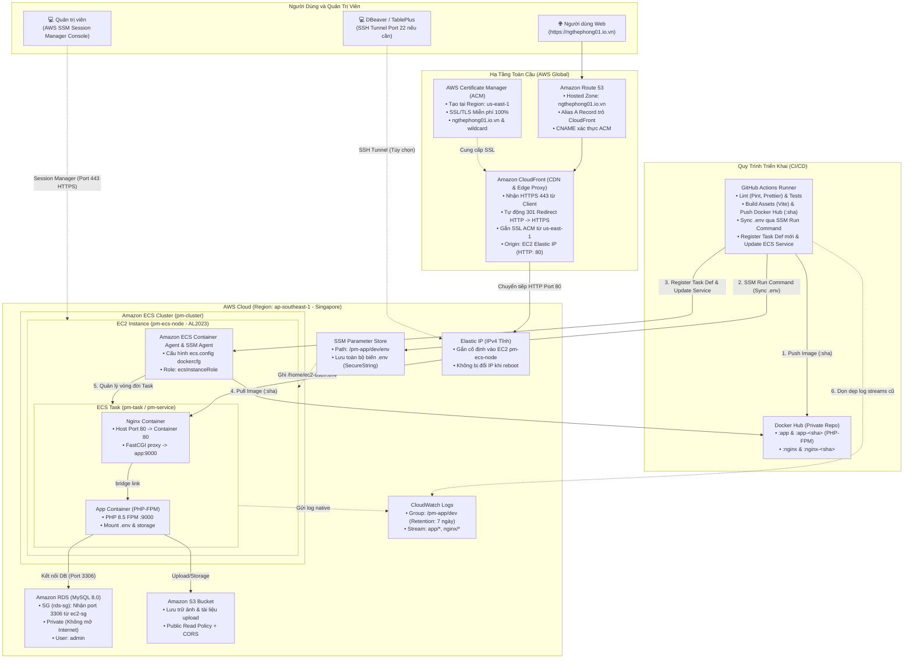

# Cẩm nang Thiết lập & Vận hành Hạ tầng AWS (Project Management)

Tài liệu này tổng hợp toàn bộ kiến thức, vai trò, quy trình từng bước thiết lập và các bài học kinh nghiệm về các dịch vụ AWS đã được chuẩn hóa trong dự án **Project Management** (`ngthephong01.io.vn`), sử dụng **Amazon ECS (EC2 Launch Type)** kết hợp **CloudFront CDN + ACM + Elastic IP**, tối ưu chi phí ($0 phát sinh thêm so với EC2 truyền thống) và tự động hóa CI/CD không cần SSH.

---

## 1. Sơ đồ Kiến trúc Tổng thể (Architecture Diagram)



---

## 2. So sánh 3 Thế hệ Kiến trúc Triển khai

| Tiêu chí | Thế hệ 1: ALB + EC2 | Thế hệ 2: CloudFront + Docker Compose | Thế hệ 3 (Hiện tại): CloudFront + Amazon ECS on EC2 |
| :--- | :--- | :--- | :--- |
| **Chi phí cố định** | ~$16.20 - $20 / tháng (ALB + LCU) | **$0 / tháng phụ trội** (CloudFront Free Tier) | **$0 / tháng phụ trội** (ECS Control Plane miễn phí 100%) |
| **Quản lý Container** | Thủ công (Docker Compose trên host) | Thủ công (`docker compose pull && up -d`) | **Amazon ECS Agent** tự giám sát, tự restart khi crash |
| **Bảo mật CI/CD** | Cần mở SSH Port 22, lưu private key `.pem` | Cần mở SSH Port 22, lưu private key `.pem` | **Không cần SSH**, đóng hoàn toàn Port 22. Deploy qua AWS IAM API |
| **Độ ổn định Deploy** | Dễ timeout SSH, kẹt script bash | Dễ timeout SSH, kẹt script bash | **Native AWS API** (Task Definition theo Git SHA + `update-service`) |
| **Đồng bộ biến `.env`** | Phải SSH vào sửa thủ công | Phải SSH vào sửa thủ công | Tự động kéo từ **SSM Parameter Store** qua `aws ssm send-command` |
| **Môi trường Server** | Phải tự cài Docker, Compose, Git, AWS CLI | Phải tự cài Docker, Compose, Git, AWS CLI | **Amazon Linux 2023 ECS-Optimized**, Docker & Agent quản lý tập trung |

---

## 3. Amazon Route 53 (DNS & Quản trị Tên miền)

### Vai trò:
- Quản lý phân giải tên miền cho `ngthephong01.io.vn`.
- Cung cấp tính năng **Alias Record** trỏ trực tiếp vào Amazon CloudFront Distribution hoàn toàn miễn phí truy vấn.

### Quy trình thiết lập:
1. **Khởi tạo Hosted Zone:**
   - Vào **Route 53** ➔ **Hosted zones** ➔ **Create hosted zone**.
   - **Domain name**: `ngthephong01.io.vn`
   - **Type**: `Public hosted zone`.
2. **Cập nhật Name Servers (NS) tại Nhà cung cấp Tên miền (Registrar):**
   - Đổi toàn bộ Name Server tại nhà cung cấp tên miền trỏ về 4 NS do Route 53 cấp.
   > [!CAUTION]
   > Phải **xóa hoàn toàn các NS mặc định của nhà cung cấp cũ**. Nếu để lẫn lộn NS cũ và mới, các DNS resolver trên thế giới sẽ truy vấn luân phiên, dẫn tới lỗi `NXDOMAIN`.
3. **Tạo bản ghi Alias A trỏ vào CloudFront:**
   - Chọn Hosted Zone `ngthephong01.io.vn` ➔ **Create record**.
   - **Record name**: để trống (cho root domain `ngthephong01.io.vn`).
   - **Record type**: `A`.
   - Bật toggle **Alias**.
   - **Route traffic to**: Chọn *Alias to CloudFront distribution*.
   - **Choose distribution**: Chọn Distribution vừa tạo (`dxxxxxxxxxxxx.cloudfront.net`).
   - Routing policy: `Simple routing`.

---

## 4. AWS Certificate Manager - ACM (Chứng chỉ SSL/TLS Miễn phí)

### Vai trò:
- Cung cấp chứng chỉ SSL/TLS chuẩn HTTPS tin cậy toàn cầu, tự động gia hạn (Auto-renewal) vĩnh viễn.

### Quy trình thiết lập:
> [!IMPORTANT]
> **Quy định của AWS:** Chứng chỉ gắn vào CloudFront **bắt buộc phải được tạo tại Region `US East (N. Virginia) us-east-1`**.

1. **Yêu cầu chứng chỉ (Request Certificate):**
   - Đổi Region sang **`US East (N. Virginia) us-east-1`**.
   - Mở dịch vụ **Certificate Manager** ➔ **Request a public certificate**.
   - **Domain names**:
     - `ngthephong01.io.vn`
     - Wildcard: `*.ngthephong01.io.vn`
   - **Validation method**: Chọn **DNS validation** ➔ Nhấn **Request**.
2. **Xác thực chứng chỉ qua Route 53:**
   - Bấm vào Certificate vừa tạo ➔ Nhấn **Create records in Route 53** ➔ Nhấn **Create records**.
   - Đợi 1 - 3 phút, trạng thái chứng chỉ sẽ chuyển sang **Issued**.

---

## 5. Amazon CloudFront (CDN, HTTPS Edge Proxy & Origin Routing)

### Vai trò:
- Đóng vai trò Reverse Proxy mặt tiền của toàn bộ hệ thống (thay thế hoàn toàn ALB).
- Tiếp nhận kết nối HTTPS (port 443) từ người dùng, giải mã SSL tại trạm Edge, chuyển tiếp traffic qua HTTP (port 80) vào Elastic IP của EC2.
- Miễn phí 1TB data transfer và 10 triệu request mỗi tháng.

### Quy trình thiết lập:
1. Vào **CloudFront** ➔ **Create a CloudFront distribution**.
2. **Origin:**
   - **Origin domain**: Dán địa chỉ **Public IPv4 DNS** của EC2 (lấy tại Details của EC2 instance: `ec2-xx-xx-xx-xx.ap-southeast-1.compute.amazonaws.com`).
   - **Protocol**: Chọn **`HTTP only`** (Port `80`).
   - **Enable Origin Shield**: Chọn **`No`**.
3. **Default cache behavior (Cấu hình chuẩn cho Laravel Web App):**
   - **Viewer protocol policy**: Chọn **`Redirect HTTP to HTTPS`**.
   - **Allowed HTTP methods**: Chọn **`GET, HEAD, OPTIONS, PUT, POST, PATCH, DELETE`**.
   - **Cache key and origin requests**:
     - **Cache policy**: Chọn **`CachingDisabled`** *(không cache session/cookie)*.
     - **Origin request policy**: Chọn **`AllViewerExceptHostHeader`** *(chuyển tiếp đầy đủ Cookie, Headers, Query string lên server)*.
4. **Web Application Firewall (WAF):**
   - Chọn **Do not enable security protections** *(tiết kiệm chi phí)*.
5. **Settings:**
   - **Alternate domain name (CNAME)**: Điền `ngthephong01.io.vn`.
   - **Custom SSL certificate**: Chọn chứng chỉ ACM tại `us-east-1`.
6. Nhấn **Create distribution**.

---

## 6. Amazon ECS (EC2 Launch Type) & EC2 Node Setup

Mô hình ECS on EC2 cho phép ta tận dụng gói máy chủ EC2 `t3.micro`/`t2.micro` tiết kiệm chi phí, trong khi control plane của ECS được miễn phí hoàn toàn.

### 1. Chuẩn bị IAM Roles:

#### A. Role cho EC2 Node (`ecsInstanceRole`):
- **Trusted Entity**: AWS Service ➔ **EC2** (`ec2.amazonaws.com`).
- **Permissions Policies**:
  - `AmazonEC2ContainerServiceforEC2Role` (để ECS Agent đăng ký vào Cluster).
  - `AmazonSSMManagedInstanceCore` (quản trị terminal từ xa qua Session Manager và nhận lệnh `aws ssm send-command` từ CI/CD để đồng bộ `.env` không cần mở SSH).
  - Quyền đọc SSM Parameter Store (`/pm-app/dev/*`) & `kms:Decrypt` để máy chủ EC2 kéo file `.env`.

#### B. Role cho ECS Task Execution (`ecsTaskExecutionRole`):
- **Trusted Entity**: AWS Service ➔ **Elastic Container Service Task** (`ecs-tasks.amazonaws.com`).
  ```json
  {
    "Version": "2012-10-17",
    "Statement": [
      {
        "Effect": "Allow",
        "Principal": {
          "Service": "ecs-tasks.amazonaws.com"
        },
        "Action": "sts:AssumeRole"
      }
    ]
  }
  ```
- **Permissions Policies**:
  - `AmazonECSTaskExecutionRolePolicy` (cho phép kéo image & ghi log CloudWatch).
  - **Inline Policy** (Quyền đọc SSM Parameter Store và KMS decrypt):
    ```json
    {
      "Version": "2012-10-17",
      "Statement": [
        {
          "Effect": "Allow",
          "Action": ["ssm:GetParameters", "ssm:GetParameter"],
          "Resource": "arn:aws:ssm:ap-southeast-1:*:parameter/pm-app/dev/*"
        },
        {
          "Effect": "Allow",
          "Action": ["kms:Decrypt"],
          "Resource": "*"
        }
      ]
    }
    ```

### 2. Khởi tạo ECS Cluster (`pm-cluster`):
- Vào **Amazon ECS** ➔ **Create cluster**.
- Cluster name: **`pm-cluster`**.
- Infrastructure: Chọn **Fargate only** (tạo cluster rỗng, máy chủ EC2 tự cấu hình sẽ tự đăng ký vào).

### 3. Khởi tạo EC2 Instance (`pm-ecs-node`):
- **AMI**: `Amazon Linux 2023 ECS-Optimized AMI` (hoặc Amazon Linux 2023 chuẩn và cài `ecs-init`).
- **Instance Type**: `t3.micro` hoặc `t2.micro`.
- **Security Group (`ec2-sg`)**: Inbound Port 80 (từ `0.0.0.0/0`), Outbound All.
- **Storage**: `20 GiB gp3`.
- **IAM instance profile**: Chọn **`ecsInstanceRole`**.
- **User data**:
  ```bash
  #!/bin/bash
  echo "ECS_CLUSTER=pm-cluster" >> /etc/ecs/ecs.config
  ```

### 4. Cấu hình máy chủ EC2 (Làm 1 lần duy nhất trên terminal):
Nếu dùng Amazon Linux 2023 tiêu chuẩn, chạy các lệnh sau:
```bash
# 1. Cài đặt ECS Agent và Docker Engine
sudo dnf install -y ecs-init
sudo usermod -aG docker ec2-user

# 2. Đăng nhập Docker Hub để lấy token chứng thực
docker login -u <DOCKERHUB_USERNAME>

# 3. Nạp thông tin cấu hình và Token vào ecs.config
AUTHS=$(python3 -c "import json; print(json.dumps(json.load(open('/home/ec2-user/.docker/config.json'))['auths']))")

sudo tee /etc/ecs/ecs.config << EOF
ECS_CLUSTER=pm-cluster
ECS_ENGINE_AUTH_TYPE=dockercfg
ECS_ENGINE_AUTH_DATA=${AUTHS}
EOF

# 4. Kích hoạt và khởi chạy ECS Agent
sudo systemctl enable --now ecs

# 5. Kéo biến môi trường .env lần đầu từ SSM Parameter Store (các lần deploy sau CI/CD sẽ tự đồng bộ)
aws ssm get-parameter \
  --region ap-southeast-1 \
  --name "/pm-app/dev/env" \
  --with-decryption \
  --query "Parameter.Value" \
  --output text | sudo tee /home/ec2-user/.env
sudo chown ec2-user:ec2-user /home/ec2-user/.env
sudo chmod 644 /home/ec2-user/.env

# 6. Khởi tạo thư mục storage upload
sudo mkdir -p /home/ec2-user/storage
sudo chmod -R 777 /home/ec2-user/storage
```

### 5. Gắn Elastic IP:
- Vào **EC2** ➔ **Elastic IPs** ➔ Chọn Elastic IP của bạn ➔ **Associate** vào instance `pm-ecs-node` mới.

---

## 7. Cloud Storage: Cloudflare R2 & Amazon S3

### Vai trò:
- Lưu trữ toàn bộ avatar, tài liệu, file đính kèm của người dùng tách biệt hoàn toàn khỏi ổ cứng EC2.

### 1. Cloudflare R2 (Lựa chọn Tối ưu Chi phí - $0 Băng thông):
Hệ thống tích hợp sẵn disk `r2` hoàn toàn tương thích S3 API:
- **10 GB dung lượng lưu trữ miễn phí hàng tháng**.
- **$0 phí băng thông tải ra (Zero Egress Fees)**: Tiết kiệm tối đa chi phí so với AWS S3 khi người dùng xem/tải nhiều ảnh/video.
- **Cấu hình trong `.env`:**
  ```ini
  FILESYSTEM_DISK=r2
  CLOUDFLARE_R2_ACCESS_KEY_ID=<your-r2-access-key-id>
  CLOUDFLARE_R2_SECRET_ACCESS_KEY=<your-r2-secret-access-key>
  CLOUDFLARE_R2_BUCKET=<your-bucket-name>
  CLOUDFLARE_R2_ENDPOINT=https://<account_id>.r2.cloudflarestorage.com
  CLOUDFLARE_R2_URL=https://<your-custom-domain-or-r2-dev-url>
  ```

### 2. Amazon S3 (AWS Native Storage):
Dùng khi `FILESYSTEM_DISK=s3`:
- Kết nối trực tiếp tới bucket Amazon S3 thật tại Region `ap-southeast-1`.
- Được cấu hình tự động thông qua SSM Parameter Store `/pm-app/dev/env` khi deploy.

### Quy trình thiết lập trên AWS S3 Thật:
1. **Tạo Bucket**: Tên duy nhất toàn cầu (ví dụ `pm-storage-phong-01`), Region `ap-southeast-1`.
2. **Bucket Policy (Public Read cho Web Client)**:
   ```json
   {
     "Version": "2012-10-17",
     "Statement": [
       {
         "Sid": "PublicReadGetObject",
         "Effect": "Allow",
         "Principal": "*",
         "Action": "s3:GetObject",
         "Resource": "arn:aws:s3:::<ten-bucket-cua-ban>/*"
       }
     ]
   }
   ```
3. **Cấu hình CORS**: Cho phép method `GET`, `HEAD` từ mọi Origin (`*`).

---

## 8. Amazon RDS (MySQL 8.0 Database)

### Vai trò:
- Cơ sở dữ liệu quan hệ MySQL đặt trong mạng nội bộ VPC, đảm bảo an toàn dữ liệu.

### Quy trình thiết lập:
1. **Khởi tạo**: MySQL 8.0, Free tier (`db.t3.micro`), Master user: `admin`, Initial database name: `project_management`, Public access: `No`.
2. **Security Group (`rds-sg`)**: Inbound port `3306` chỉ cho phép Source từ `ec2-sg`.
3. **Quản trị DB từ xa (DBeaver / TablePlus)**: Dùng tính năng **SSH Tunnel** qua Elastic IP của EC2 (hoặc qua SSM tunnel).

---

## 9. AWS SSM Parameter Store & CloudWatch Logs

### 1. SSM Parameter Store (`/pm-app/dev/env`):
- Type: `SecureString`
- Lưu toàn bộ file `.env` chứa thông tin kết nối RDS, S3, App Key, App URL...
- Mỗi khi chạy CI/CD deploy, GitHub Actions sẽ tự động gọi `aws ssm send-command` để đồng bộ nội dung mới nhất từ Parameter Store này xuống `/home/ec2-user/.env` trên EC2 node trước khi khởi chạy container mới.

### 2. CloudWatch Log Group:
- Log Group Name: **`/pm-app/dev`**
- Retention: **`7 days`** (được CI/CD tự động thiết lập và dọn dẹp các log stream cũ sau mỗi lần deploy, chỉ giữ lại 6 stream gần nhất cùng stream `notifications` để tránh phát sinh chi phí).

---

## 10. Cấu hình ECS Task Definition & Service

### 1. Task Definition (`pm-task`):
Khai báo 2 container: `app` (PHP-FPM :9000) và `nginx` (Port 80) liên kết với nhau bằng bridge link. Khi CI/CD chạy, tag của image sẽ được tự động cập nhật sang mã commit cụ thể (`:app-<git-sha>` và `:nginx-<git-sha>`) để tạo revision mới:

```json
{
  "family": "pm-task",
  "networkMode": "bridge",
  "taskRoleArn": "arn:aws:iam::<ACCOUNT_ID>:role/ecsTaskExecutionRole",
  "executionRoleArn": "arn:aws:iam::<ACCOUNT_ID>:role/ecsTaskExecutionRole",
  "containerDefinitions": [
    {
      "name": "app",
      "image": "<DOCKERHUB_USERNAME>/project-management:app",
      "essential": true,
      "memoryReservation": 400,
      "portMappings": [
        {
          "containerPort": 9000,
          "protocol": "tcp"
        }
      ],
      "mountPoints": [
        {
          "sourceVolume": "env-file",
          "containerPath": "/var/www/.env",
          "readOnly": true
        },
        {
          "sourceVolume": "storage-uploads",
          "containerPath": "/var/www/storage/app/public"
        }
      ],
      "logConfiguration": {
        "logDriver": "awslogs",
        "options": {
          "awslogs-group": "/pm-app/dev",
          "awslogs-region": "ap-southeast-1",
          "awslogs-stream-prefix": "app"
        }
      }
    },
    {
      "name": "nginx",
      "image": "<DOCKERHUB_USERNAME>/project-management:nginx",
      "essential": true,
      "memoryReservation": 128,
      "links": [
        "app"
      ],
      "portMappings": [
        {
          "hostPort": 80,
          "containerPort": 80,
          "protocol": "tcp"
        }
      ],
      "mountPoints": [
        {
          "sourceVolume": "storage-uploads",
          "containerPath": "/var/www/public/storage",
          "readOnly": true
        }
      ],
      "logConfiguration": {
        "logDriver": "awslogs",
        "options": {
          "awslogs-group": "/pm-app/dev",
          "awslogs-region": "ap-southeast-1",
          "awslogs-stream-prefix": "nginx"
        }
      }
    }
  ],
  "volumes": [
    {
      "name": "env-file",
      "host": {
        "sourcePath": "/home/ec2-user/.env"
      }
    },
    {
      "name": "storage-uploads",
      "host": {
        "sourcePath": "/home/ec2-user/storage"
      }
    }
  ]
}
```

### 2. ECS Service (`pm-service`):
- **Launch Type**: `EC2`
- **Family**: `pm-task`
- **Desired Tasks**: `1`
- **Deployment configuration**:
  - **Minimum healthy percent**: `0` *(bắt buộc vì 1 node EC2 chỉ có 1 port 80 tĩnh, ECS cần dừng task cũ trước khi khởi chạy task mới)*.
  - **Maximum percent**: `100`.

---

## 11. Tự động hóa CI/CD Pipeline (GitHub Actions deploy ECS)

File workflow [`.github/workflows/ci.yml`](file:///home/phongnt/Desktop/personal/project-management/.github/workflows/ci.yml) được chia thành 5 jobs (`backend-lint`, `frontend-lint`, `tests`, `build-and-push`, `deploy`) và sử dụng AWS CLI chính thức để triển khai lên ECS hoàn toàn không cần SSH.

### Điểm nổi bật của quy trình Build & Deploy hiện tại:
1. **Build Frontend Assets & Tag Image theo Git SHA (`build-and-push`):**
   - Chạy `npm run build` với các biến môi trường `VITE_*` trước khi đóng gói vào Docker image.
   - Đẩy đồng thời cả tag mặc định (`:app`, `:nginx`) và **tag gắn mã commit Git SHA** (`:app-${{ github.sha }}`, `:nginx-${{ github.sha }}`) lên Docker Hub để định danh chính xác phiên bản code và hỗ trợ rollback dễ dàng.
2. **Tự động đồng bộ `.env` từ SSM Parameter Store (`Sync .env from SSM Parameter Store to EC2 Node`):**
   - Tự động truy vấn EC2 Instance ID đang chạy trong `pm-cluster` và gửi lệnh qua **AWS SSM Run Command** (`AWS-RunShellScript`) để kéo bản `.env` mới nhất từ `/pm-app/dev/env` về `/home/ec2-user/.env`.
3. **Đăng ký Task Definition Revision mới theo Git SHA (`Register New ECS Task Definition with Git SHA`):**
   - Lấy cấu hình `pm-task` hiện hành, dùng `jq` thay thế image của `app` và `nginx` sang tag `-${{ github.sha }}` vừa build, và đăng ký một Task Definition revision mới trên ECS.
4. **Cập nhật ECS Service & Kiểm tra Rollout (`Trigger ECS Deployment & Validate Rollout`):**
   - Gọi `aws ecs update-service --task-definition "$NEW_TASK_DEF_ARN"` để kích hoạt rollout chuẩn của ECS, đợi service ổn định (`services-stable`) và kiểm tra `rolloutState == COMPLETED`. Nếu lỗi sẽ tự động in ra 6 ECS service events gần nhất.
5. **Tự động dọn dẹp CloudWatch Logs (`Clean up Stale CloudWatch Log Streams & Set Retention`):**
   - Đặt chính sách lưu trữ log 7 ngày (`--retention-in-days 7`) cho `/pm-app/dev` và xóa các log stream cũ (chỉ giữ lại 6 stream mới nhất và stream `notifications`).

### Chi tiết cấu hình job `deploy` trong `.github/workflows/ci.yml`:

```yaml
  deploy:
    name: Deploy to Amazon ECS
    runs-on: ubuntu-latest
    needs: [build-and-push]
    if: github.ref == 'refs/heads/main' || github.ref == 'refs/heads/master'
    steps:
      - name: Configure AWS Credentials
        uses: aws-actions/configure-aws-credentials@v4
        with:
          aws-access-key-id: ${{ secrets.AWS_ACCESS_KEY_ID }}
          aws-secret-access-key: ${{ secrets.AWS_SECRET_ACCESS_KEY }}
          aws-region: ap-southeast-1

      - name: Sync .env from SSM Parameter Store to EC2 Node
        run: |
          echo "🔄 Syncing .env from SSM Parameter Store (/pm-app/dev/env) to EC2 host..."
          
          # Discover EC2 instance backing the ECS cluster
          CONTAINER_INSTANCE_ARN=$(aws ecs list-container-instances \
            --cluster pm-cluster \
            --query "containerInstanceArns[0]" \
            --output text)
          
          if [ -n "$CONTAINER_INSTANCE_ARN" ] && [ "$CONTAINER_INSTANCE_ARN" != "None" ]; then
            INSTANCE_ID=$(aws ecs describe-container-instances \
              --cluster pm-cluster \
              --container-instances "$CONTAINER_INSTANCE_ARN" \
              --query "containerInstances[0].ec2InstanceId" \
              --output text)
            
            echo "Target EC2 Instance: $INSTANCE_ID"
            
            # Execute SSM run command to pull latest decrypted .env from Parameter Store
            COMMAND_ID=$(aws ssm send-command \
              --instance-ids "$INSTANCE_ID" \
              --document-name "AWS-RunShellScript" \
              --comment "Sync .env from SSM to /home/ec2-user/.env" \
              --parameters 'commands=["aws ssm get-parameter --region ap-southeast-1 --name /pm-app/dev/env --with-decryption --query Parameter.Value --output text > /home/ec2-user/.env", "chown ec2-user:ec2-user /home/ec2-user/.env", "chmod 644 /home/ec2-user/.env"]' \
              --query "Command.CommandId" \
              --output text)
            
            echo "SSM Command dispatched: $COMMAND_ID. Waiting for execution..."
            aws ssm wait command-executed \
              --command-id "$COMMAND_ID" \
              --instance-id "$INSTANCE_ID"
            
            echo "✅ Successfully synced latest .env to /home/ec2-user/.env on $INSTANCE_ID"
          else
            echo "⚠️ No active container instance found in pm-cluster. Skipping SSM sync."
          fi

      - name: Register New ECS Task Definition with Git SHA
        id: render-task-def
        env:
          DOCKER_USERNAME: ${{ secrets.DOCKERHUB_USERNAME }}
        run: |
          echo "📝 Rendering new Task Definition for pm-task with SHA: ${{ github.sha }}..."
          
          # 1. Fetch active task definition, update images to use SHA tag, strip metadata
          aws ecs describe-task-definition \
            --task-definition pm-task \
            --query "taskDefinition" | \
            jq --arg APP_IMAGE "$DOCKER_USERNAME/project-management:app-${{ github.sha }}" \
               --arg NGINX_IMAGE "$DOCKER_USERNAME/project-management:nginx-${{ github.sha }}" \
               'del(.taskDefinitionArn, .revision, .status, .requiresAttributes, .compatibilities, .registeredAt, .registeredBy) |
                .containerDefinitions = (.containerDefinitions | map(
                  if .name == "app" then .image = $APP_IMAGE
                  elif .name == "nginx" then .image = $NGINX_IMAGE
                  else . end
                ))' > task-def-${{ github.sha }}.json
          
          # 2. Register new task definition revision on ECS
          NEW_TASK_DEF_ARN=$(aws ecs register-task-definition \
            --cli-input-json file://task-def-${{ github.sha }}.json \
            --query "taskDefinition.taskDefinitionArn" \
            --output text)
          
          echo "✅ Registered new Task Definition: $NEW_TASK_DEF_ARN"
          echo "task_def_arn=$NEW_TASK_DEF_ARN" >> $GITHUB_OUTPUT

      - name: Trigger ECS Deployment & Validate Rollout
        run: |
          NEW_TASK_DEF_ARN="${{ steps.render-task-def.outputs.task_def_arn }}"
          echo "🚀 Updating Amazon ECS service (pm-cluster / pm-service) to new revision: $NEW_TASK_DEF_ARN..."
          
          # 1. Trigger deployment with new Task Definition (native ECS rolling rollout without --force)
          DEPLOYMENT_ID=$(aws ecs update-service \
            --cluster pm-cluster \
            --service pm-service \
            --task-definition "$NEW_TASK_DEF_ARN" \
            --query "service.deployments[?status=='PRIMARY'].id" \
            --output text)

          echo "Deployment ID: $DEPLOYMENT_ID"

          # 2. Wait 15s for ECS to register the new deployment and transition state
          echo "Waiting 15s for ECS to register rollout..."
          sleep 15

          # 3. Wait for service to reach steady state
          echo "Waiting for service to stabilize..."
          aws ecs wait services-stable \
            --cluster pm-cluster \
            --services pm-service || true

          # 4. Inspect rolloutState of the targeted deployment
          DEPLOY_INFO=$(aws ecs describe-services \
            --cluster pm-cluster \
            --services pm-service \
            --query "services[0].deployments[?id=='$DEPLOYMENT_ID'].[rolloutState, rolloutStateReason]" \
            --output text)

          ROLLOUT_STATE=$(echo "$DEPLOY_INFO" | awk '{print $1}')
          ROLLOUT_REASON=$(echo "$DEPLOY_INFO" | cut -d' ' -f2-)

          echo "Rollout State: $ROLLOUT_STATE"
          if [ -n "$ROLLOUT_REASON" ]; then
            echo "Reason: $ROLLOUT_REASON"
          fi

          # 5. If deployment failed or did not reach COMPLETED -> print recent ECS events and fail pipeline
          if [ "$ROLLOUT_STATE" = "FAILED" ] || [ -z "$ROLLOUT_STATE" ]; then
            echo "❌ Deployment FAILED! Printing recent ECS service events:"
            aws ecs describe-services \
              --cluster pm-cluster \
              --services pm-service \
              --query "services[0].events[:6].[createdAt, message]" \
              --output table
            exit 1
          fi

          echo "✅ Deployment to Amazon ECS COMPLETED successfully!"

      - name: Clean up Stale CloudWatch Log Streams & Set Retention
        run: |
          echo "🧹 Setting log retention to 7 days and cleaning up old log streams in /pm-app/dev..."
          aws logs put-retention-policy --log-group-name "/pm-app/dev" --retention-in-days 7 || true

          OLD_STREAMS=$(aws logs describe-log-streams \
            --log-group-name "/pm-app/dev" \
            --order-by LastEventTime \
            --descending \
            --query "logStreams[?logStreamName!='notifications'].logStreamName" \
            --output text | tr '\t' '\n' | tail -n +7)

          for STREAM in $OLD_STREAMS; do
            if [ -n "$STREAM" ]; then
              echo "Deleting old log stream: $STREAM"
              aws logs delete-log-stream --log-group-name "/pm-app/dev" --log-stream-name "$STREAM" || true
            fi
          done
          echo "✅ CloudWatch log streams cleanup complete."
```

### Danh sách GitHub Secrets cần thiết:
1. **AWS & Docker Hub:**
   - `AWS_ACCESS_KEY_ID`: Access Key của IAM user có quyền quản trị ECS, SSM (`SendCommand`), và CloudWatch Logs.
   - `AWS_SECRET_ACCESS_KEY`: Secret Key tương ứng.
   - `DOCKERHUB_USERNAME`: Tài khoản Docker Hub.
   - `DOCKERHUB_TOKEN`: Personal Access Token trên Docker Hub (quyền Read & Write).
2. **Biến môi trường Build Frontend (Vite & Reverb):**
   - `VITE_APP_NAME`
   - `VITE_REVERB_APP_KEY`
   - `VITE_REVERB_HOST`
   - `VITE_REVERB_PORT`
   - `VITE_REVERB_SCHEME`

*(Đã loại bỏ hoàn toàn 2 secret cũ là `EC2_HOST` và `EC2_SSH_KEY`)*.

---

## 12. Cảnh báo Chi phí AWS & Hướng dẫn Dọn dẹp (Cost Teardown)

1. **Quy trình chuyển đổi an toàn từ máy cũ sang máy mới**:
   - Khi máy mới đã chạy ổn định: Bấm **`Stop instance`** máy cũ (KHÔNG bấm Terminate vội).
   - Để máy cũ ở trạng thái Stopped trong 2-3 ngày để theo dõi. Sau khi hoàn toàn an tâm, bấm **`Terminate`** để giải phóng dung lượng ổ cứng EBS ($0.10/GB/tháng).
2. **Quy tắc Elastic IP**:
   - Chỉ giữ Elastic IP khi nó đang được gắn vào một instance ở trạng thái **Running**.
   - Nếu bạn Stop tất cả EC2, hãy vào Elastic IPs và chọn **Release** để không bị phạt $0.005/giờ.
3. **Quy tắc RDS MySQL**:
   - Nếu bạn Stop RDS, AWS sẽ tự động bật lại sau 7 ngày. Muốn dừng hẳn hãy Delete và tạo Final Snapshot.

---

## 13. Tổng kết Kỹ thuật & Bài học Kinh nghiệm Thực tế (Gotchas & Best Practices)

| Tình huống / Lỗi thực tế | Nguyên nhân gốc rễ | Giải pháp chuẩn mực đã áp dụng |
| :--- | :--- | :--- |
| **Lỗi `ECS was unable to assume the role ...`** | Role `ecsTaskExecutionRole` tạo với Trusted Entity là `ec2.amazonaws.com`. | Sửa Trust Relationship trong IAM thành **`ecs-tasks.amazonaws.com`**. |
| **Lỗi `Unit ecs.service not found` trên AL2023** | Chọn Amazon Linux 2023 bản tiêu chuẩn chưa tích hợp gói ECS agent. | Chạy `sudo dnf install -y ecs-init` và `sudo systemctl enable --now ecs`. |
| **Lỗi `CannotPullImageManifestError / authentication required`** | Docker Hub là Private Repo, ECS Agent chưa có thông tin đăng nhập hoặc cấu hình sai định dạng. | Đăng nhập bằng `docker login`, trích xuất `dockercfg` vào `/etc/ecs/ecs.config` với `ECS_ENGINE_AUTH_TYPE=dockercfg`. |
| **Lỗi `pull access denied` dù đã login Docker thành công** | Personal Access Token trên Docker Hub tạo với quyền `Public Repo Read-only`. | Tạo lại Access Token trên Docker Hub với quyền **`Read & Write`** (hoặc `Read, Write, Delete`). |
| **Lỗi `Port 80 already allocated` khi ECS Service deploy** | Trên 1 máy chủ EC2 chỉ có 1 Port 80 duy nhất, nếu rolling update 200% thì task mới không bind được port 80. | Đặt `Minimum healthy percent = 0` và `Maximum percent = 100` trong cấu hình ECS Service Deployment. |
| **Cập nhật `.env` trên SSM nhưng container vẫn nhận biến cũ** | Container mount `/home/ec2-user/.env` từ máy chủ EC2, nếu chỉ sửa trên SSM mà không kéo về EC2 thì file trên host không đổi. | Thêm bước tự động gọi `aws ssm send-command` (`AWS-RunShellScript`) trong CI/CD để đồng bộ `/pm-app/dev/env` về `/home/ec2-user/.env` trước mỗi lần deploy. |
| **Quản lý phiên bản Image & Rollback trên ECS** | Chỉ dùng tag `:app` / `:nginx` kèm `--force-new-deployment` khiến khó truy vết commit đang chạy và dễ dính cache image cũ. | Gắn thêm tag bất biến `:${{ github.sha }}` khi build image, dùng `jq` tạo và đăng ký Task Definition revision mới cho mỗi lần deploy. |
| **Bảo mật đóng Port 22 SSH** | Triển khai ECS giúp điều khiển deploy qua AWS API (`aws ecs update-service`). | Đóng Port 22 trên `ec2-sg`, khi cần terminal thì dùng **AWS SSM Session Manager** trên browser. |
